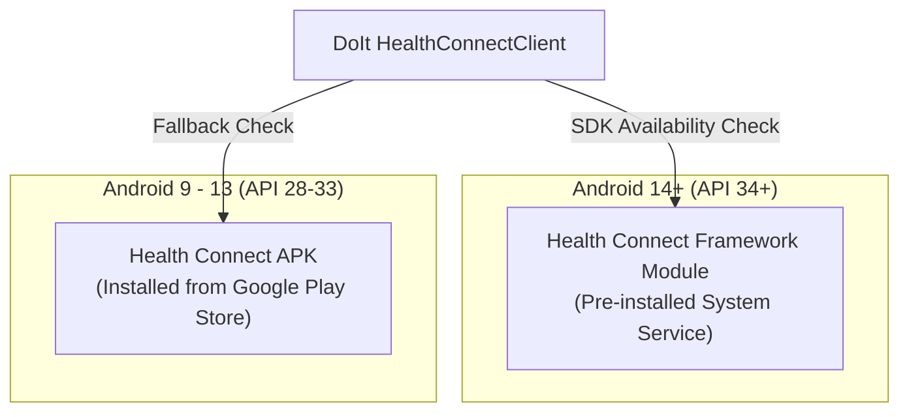
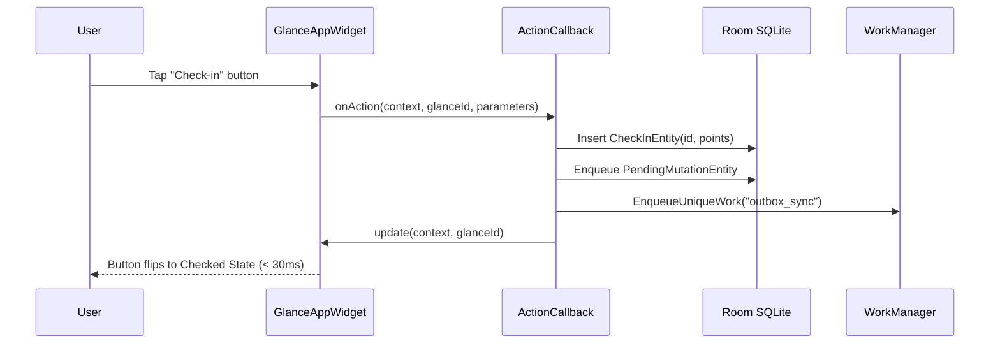

# Do It — Android Developer Setup & Implementation Guide

This guide details the complete developer environment setup, Gradle version catalog, Health Connect permissions, emulator testing, Room database migrations, Jetpack Glance widgets, and APK/AAB build pipelines for the native **Do It** Android application.

---

## 1. Prerequisites & Environment Requirements

| Component | Minimum Specification | Recommended |
| :--- | :--- | :--- |
| **Android Studio** | Android Studio Iguana (2023.2.1) | Android Studio Ladybug (2024.2.1+) |
| **JDK Version** | OpenJDK 17 | OpenJDK 21 LTS |
| **Android SDK Build-Tools** | 34.0.0 | 35.0.0 |
| **compileSdk / targetSdk** | 34 (Android 14) | 35 (Android 15) |
| **minSdk** | 28 (Android 9.0 Pie) | 28 |
| **Kotlin Version** | 2.0.0 (Compose Compiler Plugin) | 2.0.21+ |
| **Gradle Version** | 8.7+ | 8.10+ |

### Gradle Version Catalog (`gradle/libs.versions.toml`)

```toml
[versions]
agp = "8.7.1"
kotlin = "2.0.21"
coreKtx = "1.13.1"
lifecycleRuntime = "2.8.6"
activityCompose = "1.9.3"
composeBom = "2024.10.00"
room = "2.6.1"
healthConnect = "1.1.0-alpha10"
glance = "1.1.1"
workManager = "2.9.1"
supabase = "3.0.1"
ktor = "3.0.0"
securityCrypto = "1.1.0-alpha06"

[libraries]
androidx-core-ktx = { group = "androidx.core", name = "core-ktx", version.ref = "coreKtx" }
androidx-lifecycle-runtime-ktx = { group = "androidx.lifecycle", name = "lifecycle-runtime-ktx", version.ref = "lifecycleRuntime" }
androidx-activity-compose = { group = "androidx.activity", name = "activity-compose", version.ref = "activityCompose" }

# Compose BOM
androidx-compose-bom = { group = "androidx.compose", name = "compose-bom", version.ref = "composeBom" }
androidx-ui = { group = "androidx.compose.ui", name = "ui" }
androidx-ui-graphics = { group = "androidx.compose.ui", name = "ui-graphics" }
androidx-material3 = { group = "androidx.compose.material3", name = "material3" }

# Room SQLite
androidx-room-runtime = { group = "androidx.room", name = "room-runtime", version.ref = "room" }
androidx-room-ktx = { group = "androidx.room", name = "room-ktx", version.ref = "room" }
androidx-room-compiler = { group = "androidx.room", name = "room-compiler", version.ref = "room" }
androidx-room-testing = { group = "androidx.room", name = "room-testing", version.ref = "room" }

# Health Connect
androidx-health-connect = { group = "androidx.health.connect", name = "connect-client", version.ref = "healthConnect" }

# Jetpack Glance Widgets
androidx-glance-appwidget = { group = "androidx.glance", name = "glance-appwidget", version.ref = "glance" }
androidx-glance-material3 = { group = "androidx.glance", name = "glance-material3", version.ref = "glance" }

# WorkManager
androidx-work-runtime-ktx = { group = "androidx.work", name = "work-runtime-ktx", version.ref = "workManager" }

# Supabase Kotlin SDK
supabase-postgrest = { group = "io.github.jan-tennert.supabase", name = "postgrest-kt", version.ref = "supabase" }
supabase-realtime = { group = "io.github.jan-tennert.supabase", name = "realtime-kt", version.ref = "supabase" }
supabase-auth = { group = "io.github.jan-tennert.supabase", name = "auth-kt", version.ref = "supabase" }
supabase-storage = { group = "io.github.jan-tennert.supabase", name = "storage-kt", version.ref = "supabase" }
ktor-client-android = { group = "io.ktor", name = "ktor-client-android", version.ref = "ktor" }

# Hardware Keystore / Security
androidx-security-crypto = { group = "androidx.security", name = "security-crypto", version.ref = "securityCrypto" }

[plugins]
android-application = { id = "com.android.application", version.ref = "agp" }
kotlin-android = { id = "org.jetbrains.kotlin.android", version.ref = "kotlin" }
compose-compiler = { id = "org.jetbrains.kotlin.plugin.compose", version.ref = "kotlin" }
ksp = { id = "com.google.devtools.ksp", version = "2.0.21-1.0.25" }
```

---

## 2. Project Directory Structure

```
android/
└── DoIt/
    ├── build.gradle.kts                        # Root project Gradle build file
    ├── settings.gradle.kts                     # Gradle settings and module inclusion
    ├── gradle/
    │   └── libs.versions.toml                  # Version Catalog for dependencies
    ├── gradlew                                 # Gradle wrapper script
    └── app/
        ├── build.gradle.kts                    # App module dependencies & plugins
        ├── proguard-rules.pro                  # R8 optimization rules
        └── src/
            ├── main/
            │   ├── AndroidManifest.xml         # Health Connect permissions & receivers
            │   ├── java/com/doit/app/
            │   │   ├── DoItApplication.kt     # App context and Supabase initialization
            │   │   ├── model/                  # Domain Models (Habit, CheckIn, Duel, etc.)
            │   │   │   └── DomainModels.kt
            │   │   ├── data/
            │   │   │   ├── local/              # Room Database, Converters, DAOs, Entities
            │   │   │   │   ├── DoItDatabase.kt
            │   │   │   │   ├── Converters.kt
            │   │   │   │   ├── dao/Daos.kt
            │   │   │   │   └── entity/Entities.kt
            │   │   │   ├── remote/             # Supabase Auth, PostgREST, Realtime
            │   │   │   │   ├── SupabaseConfig.kt
            │   │   │   │   ├── SupabaseClient.kt
            │   │   │   │   └── SupabaseRealtimeClient.kt
            │   │   │   ├── health/             # Health Connect SDK Manager
            │   │   │   │   └── HealthConnectManager.kt
            │   │   │   └── repository/         # ScoreCalculator & Repositories
            │   │   │       └── ScoreCalculator.kt
            │   │   └── widget/                 # Jetpack Glance Home screen widgets
            │   │       ├── DoItGlanceWidget.kt
            │   │       ├── DoItWidgetReceiver.kt
            │   │       └── CheckInGlanceAction.kt
            │   └── res/
            │       ├── xml/
            │       │   ├── appwidget_info.xml
            │       │   └── health_permissions.xml
            │       └── values/
            │           ├── strings.xml
            │           ├── colors.xml
            │           └── themes.xml
            └── test/
                └── java/com/doit/app/
                    └── ScoreCalculatorTest.kt
```

---

## 3. Health Connect Setup & Android Manifest

On Android 14+ (API 34+), Health Connect is a core system framework module. On Android 13 and below, it operates as an APK installed from the Google Play Store.



### 3.1 AndroidManifest.xml Declarations

Add permissions, package queries, and the mandatory privacy rationale activity:

```xml
<?xml version="1.0" encoding="utf-8"?>
<manifest xmlns:android="http://schemas.android.com/apk/res/android">

    <!-- Health Connect Permissions -->
    <uses-permission android:name="android.permission.health.READ_STEPS" />
    <uses-permission android:name="android.permission.health.READ_SLEEP" />
    <uses-permission android:name="android.permission.health.READ_EXERCISE" />

    <!-- Network & Hardware Permissions -->
    <uses-permission android:name="android.permission.INTERNET" />
    <uses-permission android:name="android.permission.ACCESS_NETWORK_STATE" />
    <uses-permission android:name="android.permission.CAMERA" />

    <!-- Query Health Connect Provider Package -->
    <queries>
        <package android:name="com.google.android.apps.healthdata" />
        <intent>
            <action android:name="androidx.health.ACTION_SHOW_PERMISSIONS_RATIONALE" />
        </intent>
    </queries>

    <application
        android:name=".DoItApplication"
        android:icon="@mipmap/ic_launcher"
        android:label="@string/app_name"
        android:roundIcon="@mipmap/ic_launcher_round"
        android:theme="@style/Theme.DoIt">

        <!-- Main Activity -->
        <activity
            android:name=".MainActivity"
            android:exported="true"
            android:theme="@style/Theme.DoIt">
            <intent-filter>
                <action android:name="android.intent.action.MAIN" />
                <category android:name="android.intent.category.LAUNCHER" />
            </intent-filter>
        </activity>

        <!-- Mandatory Google Health Connect Privacy Policy Activity -->
        <activity
            android:name=".telemetry.HealthPermissionsRationaleActivity"
            android:exported="true">
            <intent-filter>
                <action android:name="androidx.health.ACTION_SHOW_PERMISSIONS_RATIONALE" />
            </intent-filter>
        </activity>

        <activity-alias
            android:name="ViewPermissionUsageActivity"
            android:exported="true"
            android:targetActivity=".telemetry.HealthPermissionsRationaleActivity"
            android:permission="android.permission.START_VIEW_PERMISSION_USAGE">
            <intent-filter>
                <action android:name="android.intent.action.VIEW_PERMISSION_USAGE" />
                <category android:name="android.intent.category.HEALTH_PERMISSIONS" />
            </intent-filter>
        </activity-alias>

        <!-- Glance Widget Receiver -->
        <receiver
            android:name=".widget.DoItWidgetReceiver"
            android:exported="true">
            <intent-filter>
                <action android:name="android.appwidget.action.APPWIDGET_UPDATE" />
            </intent-filter>
            <meta-data
                android:name="android.appwidget.provider"
                android:resource="@xml/doit_widget_info" />
        </receiver>

    </application>
</manifest>
```

### 3.2 Emulator Configuration & Telemetry Data Injection

To test Health Connect on the emulator:

1. **Create an Android Virtual Device (AVD)**:
   - Target: **Google APIs Intel x86_64 Atom System Image** (API 34 or API 35).
   - Ensure the Play Store icon is enabled on the target image.
2. **Install Health Connect & Developer Toolbox**:
   Install the official Google Health Connect Toolbox via ADB to mock biometric data:

```bash
# Download and install Health Connect Toolbox APK
adb install -r health-connect-toolbox.apk

# Inject Mock Steps Record (e.g. 10,500 steps for today)
adb shell am broadcast -a com.google.android.apps.healthdata.toolbox.INSERT_DATA \
  --es dataType "STEPS" \
  --ei count 10500 \
  --es startTime "$(date -u +%Y-%m-%dT08:00:00Z)" \
  --es endTime "$(date -u +%Y-%m-%dT20:00:00Z)"

# Inject Mock Sleep Session (7.8 hours asleep)
adb shell am broadcast -a com.google.android.apps.healthdata.toolbox.INSERT_DATA \
  --es dataType "SLEEP_SESSION" \
  --es startTime "$(date -u -d 'yesterday 23:00' +%Y-%m-%dT23:00:00Z)" \
  --es endTime "$(date -u +%Y-%m-%dT06:48:00Z)" \
  --es stage "SLEEPING"
```

---

## 4. Room Database Architecture & Safe Migrations

### 4.1 Room Database Entities & DAO

```kotlin
package com.doit.app.core.database.entity

import androidx.room.ColumnInfo
import androidx.room.Entity
import androidx.room.Index
import androidx.room.PrimaryKey

@Entity(
    tableName = "duel_check_ins",
    indices = [
        Index(value = ["duel_id", "habit_id", "date"], unique = true)
    ]
)
data class CheckInEntity(
    @PrimaryKey
    val id: String,
    @ColumnInfo(name = "duel_id")
    val duelId: String,
    @ColumnInfo(name = "habit_id")
    val habitId: String,
    @ColumnInfo(name = "player_slot")
    val playerSlot: String,
    val date: String, // YYYY-MM-DD
    @ColumnInfo(name = "points_earned")
    val pointsEarned: Int,
    val quantity: Double? = null,
    val source: String = "manual", // manual | wearable
    @ColumnInfo(name = "health_value")
    val healthValue: Double? = null,
    @ColumnInfo(name = "completed_at")
    val completedAt: String
)

@Entity(tableName = "pending_mutations")
data class PendingMutationEntity(
    @PrimaryKey
    val mutationId: String,
    @ColumnInfo(name = "duel_id")
    val duelId: String,
    @ColumnInfo(name = "table_name")
    val tableName: String,
    @ColumnInfo(name = "operation")
    val operation: String, // INSERT | UPDATE | UPSERT | DELETE
    @ColumnInfo(name = "record_id")
    val recordId: String,
    val payload: String, // JSON serialization
    @ColumnInfo(name = "created_at")
    val createdAt: Long = System.currentTimeMillis(),
    @ColumnInfo(name = "retry_count")
    val retryCount: Int = 0
)
```

### 4.2 Safe Migrations & MigrationTestHelper

Create deterministic schema migrations to prevent production database resets:

```kotlin
package com.doit.app.core.database

import androidx.room.Database
import androidx.room.RoomDatabase
import androidx.room.migration.Migration
import androidx.sqlite.db.SupportSQLiteDatabase
import com.doit.app.core.database.dao.CheckInDao
import com.doit.app.core.database.dao.MutationDao
import com.doit.app.core.database.entity.CheckInEntity
import com.doit.app.core.database.entity.PendingMutationEntity

@Database(
    entities = [CheckInEntity::class, PendingMutationEntity::class],
    version = 2,
    exportSchema = true
)
abstract class DoItDatabase : RoomDatabase() {
    abstract fun checkInDao(): CheckInDao
    abstract fun mutationDao(): MutationDao

    companion object {
        val MIGRATION_1_2 = object : Migration(1, 2) {
            override fun migrate(db: SupportSQLiteDatabase) {
                // Add health_value column to duel_check_ins
                db.execSQL("ALTER TABLE duel_check_ins ADD COLUMN health_value REAL DEFAULT NULL")
            }
        }
    }
}
```

Verify migrations using `MigrationTestHelper`:

```kotlin
@RunWith(AndroidJUnit4::class)
class MigrationTest {
    private val TEST_DB = "migration-test"

    @get:Rule
    val helper: MigrationTestHelper = MigrationTestHelper(
        InstrumentationRegistry.getInstrumentation(),
        DoItDatabase::class.java.canonicalName,
        FrameworkSQLiteOpenHelperFactory()
    )

    @Test
    fun migrate1To2_containsHealthValueColumn() {
        var db = helper.createDatabase(TEST_DB, 1).apply {
            execSQL("INSERT INTO duel_check_ins (id, duel_id, habit_id, player_slot, date, points_earned, source, completed_at) VALUES ('c1', 'd1', 'h1', 'maciek', '2026-10-12', 40, 'manual', '2026-10-12T10:00:00Z')")
            close()
        }

        db = helper.runMigrationsAndValidate(TEST_DB, 2, true, DoItDatabase.MIGRATION_1_2)
        val cursor = db.query("SELECT health_value FROM duel_check_ins WHERE id = 'c1'")
        assertTrue(cursor.moveToFirst())
        assertTrue(cursor.isNull(0))
    }
}
```

---

## 5. Jetpack Glance Widget Setup

Glance enables Jetpack Compose declarative styling for AppWidgets, backed by an `ActionCallback` for zero-friction interactive check-ins.



### 5.1 GlanceAppWidget Implementation (`DoItGlanceWidget.kt`)

```kotlin
package com.doit.app.widget

import android.content.Context
import androidx.compose.runtime.Composable
import androidx.compose.ui.unit.dp
import androidx.compose.ui.unit.sp
import androidx.glance.GlanceId
import androidx.glance.GlanceModifier
import androidx.glance.GlanceTheme
import androidx.glance.action.ActionParameters
import androidx.glance.action.actionParametersOf
import androidx.glance.action.actionStartActivity
import androidx.glance.appwidget.GlanceAppWidget
import androidx.glance.appwidget.action.ActionCallback
import androidx.glance.appwidget.action.actionRunCallback
import androidx.glance.appwidget.provideContent
import androidx.glance.background
import androidx.glance.layout.*
import androidx.glance.text.FontWeight
import androidx.glance.text.Text
import androidx.glance.text.TextStyle
import com.doit.app.MainActivity

class DoItGlanceWidget : GlanceAppWidget() {
    override suspend fun provideGlance(context: Context, id: GlanceId) {
        provideContent {
            GlanceTheme {
                WidgetContent()
            }
        }
    }

    @Composable
    private fun WidgetContent() {
        Column(
            modifier = GlanceModifier
                .fillMaxSize()
                .padding(16.dp)
                .background(GlanceTheme.colors.surface),
            verticalAlignment = Alignment.Vertical.CenterVertically
        ) {
            Text(
                text = "DO IT — 240 PAR",
                style = TextStyle(
                    color = GlanceTheme.colors.onSurface,
                    fontSize = 12.sp,
                    fontWeight = FontWeight.Bold
                )
            )
            Spacer(modifier = GlanceModifier.height(8.dp))
            Row(
                modifier = GlanceModifier.fillMaxWidth(),
                horizontalAlignment = Alignment.Horizontal.CenterHorizontally
            ) {
                // Interactive 1-tap logging button
                GlanceButton(
                    text = "Gym (40 pts)",
                    habitId = "gym-workout",
                    points = 40
                )
            }
        }
    }

    @Composable
    private fun GlanceButton(text: String, habitId: String, points: Int) {
        androidx.glance.Button(
            text = text,
            onClick = actionRunCallback<CheckInActionCallback>(
                actionParametersOf(
                    HabitIdKey to habitId,
                    PointsKey to points
                )
            )
        )
    }

    companion object {
        val HabitIdKey = ActionParameters.Key<String>("habit_id")
        val PointsKey = ActionParameters.Key<Int>("points")
    }
}

class CheckInActionCallback : ActionCallback {
    override suspend fun onAction(
        context: Context,
        glanceId: GlanceId,
        parameters: ActionParameters
    ) {
        val habitId = parameters[DoItGlanceWidget.HabitIdKey] ?: return
        val points = parameters[DoItGlanceWidget.PointsKey] ?: return
        
        // Asynchronously commit check-in to Room and trigger OutboxSyncWorker
        CheckInRepository.quickLog(context, habitId, points)
        
        // Refresh widget appearance
        DoItGlanceWidget().update(context, glanceId)
    }
}
```

---

## 6. Building, Signing & Release Automation

### 6.1 ProGuard / R8 Optimization Rules (`app/proguard-rules.pro`)

```pro
# Supabase Kotlin SDK Serialization
-keepattributes *Annotation*, Signature, InnerClasses, EnclosingMethod
-keepclassmembers class * {
    @kotlinx.serialization.Serializable <fields>;
}
-keep class io.github.jan.supabase.** { *; }

# AndroidX Room
-keepclassmembers class * extends androidx.room.RoomDatabase {
    <init>();
}
-keep class * extends androidx.room.RoomDatabase
-dontwarn androidx.room.paging.**

# Health Connect Client
-keep class androidx.health.connect.client.** { *; }

# Jetpack Glance
-keep class androidx.glance.** { *; }
```

### 6.2 CLI Build Commands

```bash
# 1. Run unit and Room migration tests
./gradlew testDebugUnitTest

# 2. Assemble Debug APK for local testing on device/emulator
./gradlew assembleDebug

# Output APK path:
# app/build/outputs/apk/debug/app-debug.apk

# 3. Build Signed Production Android App Bundle (AAB) for Google Play
./gradlew bundleRelease

# Output AAB path:
# app/build/outputs/bundle/release/app-release.aab
```
