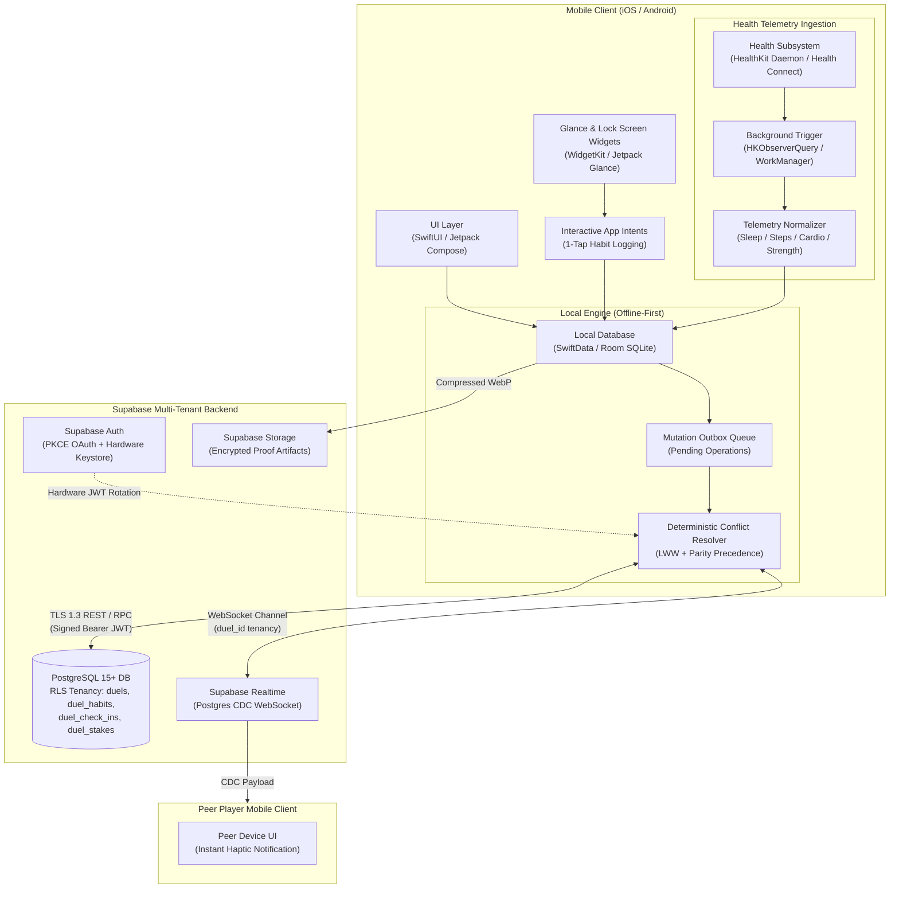
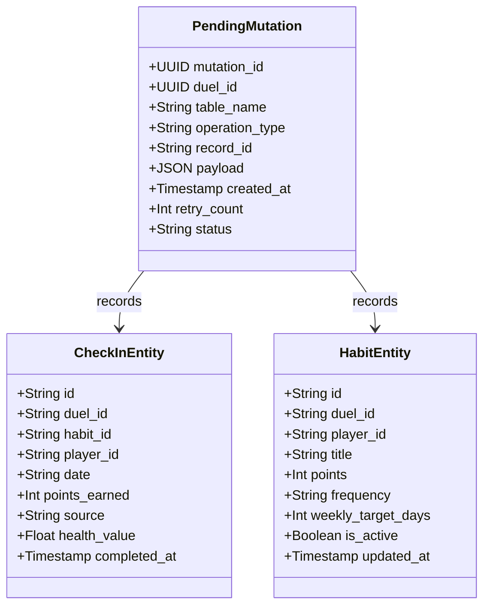
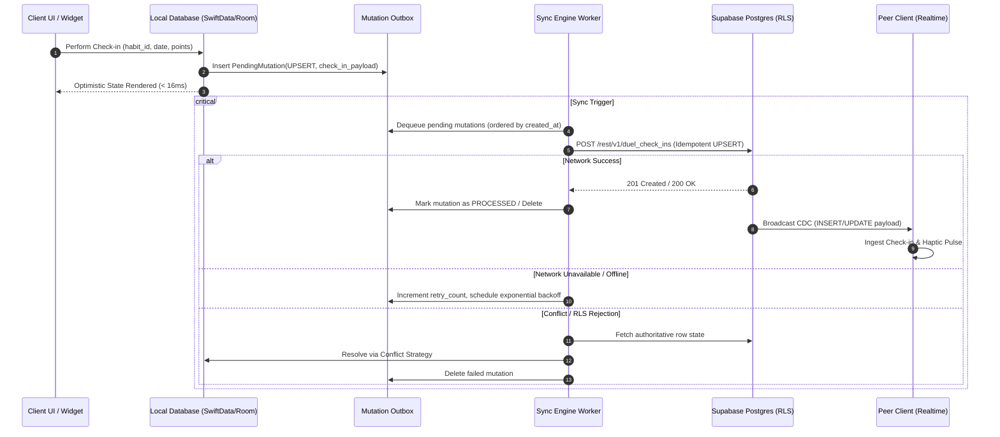
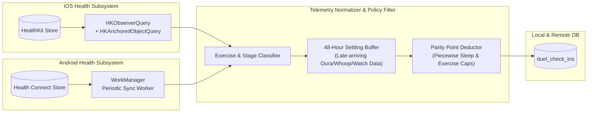
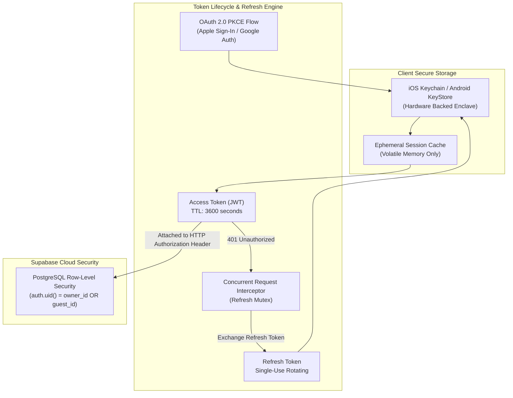

# Do It — Mobile System Architecture

This document defines the high-level system architecture, cross-platform technical parity matrix, offline-first synchronization protocol, health telemetry pipelines, and security standards for the native **Do It** iOS and Android applications.

---

## 1. High-Level System Architecture

Do It is an asymmetric two-player habit accountability platform built on a calibrated **240 Daily Par** economic model. The mobile ecosystem delivers zero-friction habit completion, biometric wearable automation, and sub-second dual-player synchronization across mobile platforms and the existing web client.



### Core Architecture Principles

1. **Local-First Supremacy**: Every user action (habit check-in, rest day request, cheer reaction, stake update) commits to the local transactional database first (`SwiftData` on iOS, `Room` on Android). The user interface renders state updates synchronously with zero network latency.
2. **Deterministic Asymmetric Parity**: Competitors choose different lifestyle habits (e.g., Strength Training vs. Pilates), but both compete against calibrated weekly target points and an equivalent **240 Daily Par** ceiling.
3. **Idempotent Multi-Tenancy**: Data is strictly scoped to a `duel_id` shared between an `owner` and a `guest` player slot. The database layer enforces multi-tenant isolation via PostgreSQL Row-Level Security (RLS) policies and composite unique constraints: `(duel_id, habit_id, date)`.
4. **Autonomous Biometric Automation**: Wearable telemetry is evaluated locally on the client against habit thresholds. Validated readings produce check-in records without requiring cloud roundtrips or exposing unconsented raw health metrics to backend servers.

---

## 2. Cross-Platform Parity Matrix

The native mobile architecture mirrors the domain model and gamification engine of the web platform while taking full advantage of low-level operating system capabilities.

| Capability Layer | Web Client (`src/`) | iOS Native (`ios/`) | Android Native (`android/`) |
| :--- | :--- | :--- | :--- |
| **Language & Runtime** | TypeScript 5.5 / Node.js 20 | Swift 6 / Swift Concurrency (`Sendable`) | Kotlin 2.0+ / Coroutines & Flow |
| **UI Framework** | Next.js 15 / React 19 / Tailwind CSS | SwiftUI (Declarative / StateObject / Observation) | Jetpack Compose (Material 3 Adaptive) |
| **Local Persistence** | `localStorage` / IndexedDB caching | SwiftData (`@Model`) backed by SQLite | Room Persistence Library (`@Entity`) |
| **Reactive State** | React Context / Custom Hooks | Swift Observation (`@Observable`) | Jetpack ViewModel + `StateFlow` |
| **Health Telemetry** | Google Health REST API (OAuth cron) | HealthKit (`HKHealthStore` + Background Delivery) | Health Connect API (`HealthConnectClient` + SDK) |
| **Home Screen Widgets** | PWA Manifest shortcuts | WidgetKit (Small, Medium, Lock Screen Accessory) | Jetpack Glance (`GlanceAppWidget`) |
| **1-Tap Interactive Logging** | Web click handler | App Intents (`AppIntent` in WidgetKit) | Glance `ActionCallback` + WorkManager |
| **Push Notifications** | Web Push API (Service Worker) | Apple Push Notification service (APNs) | Firebase Cloud Messaging (FCM) |
| **Biometric Auth & Tokens** | Browser Cookies / Session Storage | Apple Keychain Services (`kSecAttrAccessible`) | Android KeyStore + `EncryptedSharedPreferences` |
| **Photo Proof Pipeline** | Browser Canvas Client Compression | CoreImage / AVFoundation WebP compression | AndroidX ImageCapture / WebP Transcoder |
| **Realtime Sync** | `@supabase/supabase-js` WebSocket | `Supabase-Swift` Realtime Channel | `Supabase-kt` Realtime Channel |

---

## 3. Offline-First Synchronization Protocol

The Do It synchronization protocol guarantees that two players maintain synchronized game state even during intermittent network connectivity, airplane mode, or background execution limits.

### 3.1 Data Model & Outbox Pattern

All local modifications write transactionally to both the domain table and a local `PendingMutation` outbox table.



### 3.2 Bidirectional Sync Flow



### 3.3 Conflict Resolution Rules

The synchronization engine enforces three strict conflict rules:

1. **Composite Uniqueness on Check-ins**:
   Check-ins are uniquely identified by the tuple `(duel_id, habit_id, date)`. An insert for an existing tuple becomes a deterministic update:
   $$\text{CheckInID} = \text{"health-" } \Vert \text{ habit\_id } \Vert \text{ "-" } \Vert \text{ date}$$
2. **Manual Check-In Precedence**:
   If a user records a manual check-in (`source = "manual"`), incoming automated wearable sync (`source = "wearable"`) **must never overwrite** the manual record, even if the wearable sync finishes later. The only exception is if the manual check-in was explicitly marked as a temporary placeholder within the 48-hour trailing settling window.
3. **Last-Write-Wins (LWW) with Lamport Timestamps for Non-Point Entities**:
   Habit configurations, duel stakes, and reaction cheers utilize UTC ISO-8601 timestamps (`updated_at`). Remote changes with newer timestamps overwrite local cached versions, triggering an automatic UI state re-render.
4. **Exponential Backoff and Jitter**:
   Failed mutations retry using decorrelated full jitter to prevent thundering herds when recovering from connectivity outages:
   $$t_{\text{sleep}} = \min(t_{\text{max}}, \; \text{random}(0, \; t_{\text{base}} \times 2^{\text{retry\_count}}))$$
   Where $t_{\text{base}} = 1.5\text{s}$ and $t_{\text{max}} = 300\text{s}$.

---

## 4. Health Telemetry Pipeline (HealthKit + Health Connect)

The mobile clients interface directly with device health daemons rather than relying on third-party cloud polling.



### 4.1 Native Health Ingestion Mechanics

#### iOS (Apple HealthKit)
- **Observer Queries**: Registers an `HKObserverQuery` for:
  - `HKCategoryTypeIdentifier.sleepAnalysis`
  - `HKQuantityTypeIdentifier.stepCount`
  - `HKWorkoutTypeIdentifier`
- **Background Delivery**: Invokes `HKHealthStore.enableBackgroundDelivery(for:frequency:priority:)` set to `.immediate` for workouts and `.hourly` for steps and sleep.
- **Anchored Object Queries**: Uses `HKAnchoredObjectQuery` to fetch incremental delta records since the previous persistent anchor, minimizing battery drain and memory footprint.

#### Android (Health Connect)
- **System Integration**: Uses the Android 14+ Jetpack Health Connect API (`androidx.health.connect.client.HealthConnectClient`).
- **Changes Token Sync**: Stores a persistent `changesToken` to fetch only mutated records via `getChanges(changesToken)`.
- **Scheduled Background Sync**: Registers a periodic `CoroutineWorker` scheduled every 15 minutes with constraints:
  - `NetworkType.CONNECTED`
  - `BatteryNotLow(true)`

### 4.2 Settling Windows & Delay Handling
Wearable devices (Oura Ring, Whoop, Apple Watch, Garmin) often compute sleep stages or sync workouts hours after the event occurs.
- The telemetry engine inspects a **trailing 48-hour window** (`[today - 2 days, today]`).
- Sleep records recalculate automatically if sleep stage updates arrive before the 48-hour cutoff.
- Any check-in updated during this settling window updates the remote Supabase record with `source: "wearable"`.

---

## 5. Security, Authentication & Token Handling

Do It enforces a zero-trust model for client-side cryptographic storage, credential lifecycles, and database row access.



### 5.1 Credential Storage & Encryption

- **iOS Implementation**:
  - Refresh tokens, access tokens, and duel invitation secrets are stored using Apple Keychain Services (`Security.framework`).
  - Access control flag: `kSecAttrAccessibleAfterFirstUnlockThisDeviceOnly`.
  - Disallows unencrypted iCloud Keychain synchronization to prevent cross-device session leaks.
- **Android Implementation**:
  - Tokens are encrypted via `EncryptedSharedPreferences` backed by Android KeyStore (`MasterKey.DEFAULT_AES256_GCM_SPEC`).
  - Hardware cryptographic keys are sealed inside the device Trusted Execution Environment (TEE) or StrongBox Keymaster.

### 5.2 Multi-Tenant Row-Level Security (RLS) Enforcement

Every database read, write, and realtime subscription is constrained by PostgreSQL RLS policies matching the authenticated Supabase user ID:

```sql
-- Enforces that a player can only read habits within their duel
CREATE POLICY "Members read habits" ON public.duel_habits
  FOR SELECT TO authenticated
  USING (
    EXISTS (
      SELECT 1 FROM public.duels d 
      WHERE d.id = duel_id 
        AND (d.owner_id = auth.uid() OR d.guest_id = auth.uid())
    )
  );

-- Enforces that a player can only modify habits for their assigned slot
CREATE POLICY "Players write own habits" ON public.duel_habits
  FOR INSERT TO authenticated
  WITH CHECK (
    EXISTS (
      SELECT 1 FROM public.duels d 
      WHERE d.id = duel_id 
        AND (
          (player_slot = 'maciek' AND d.owner_id = auth.uid()) OR 
          (player_slot = 'myrna' AND d.guest_id = auth.uid())
        )
    )
  );
```

### 5.3 Token Refresh Mutex Pipeline
When access tokens expire (HTTP 401), concurrent network requests pause behind an asynchronous mutex. Exactly one request exchanges the single-use refresh token with the Supabase Auth server, updates the secure hardware keystore, and unblocks waiting requests with the new token. If token rotation fails, all sessions are cleared, and the user is redirected to the native authentication screen.
