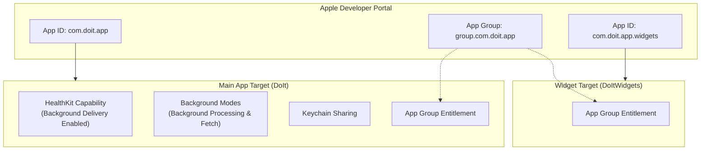
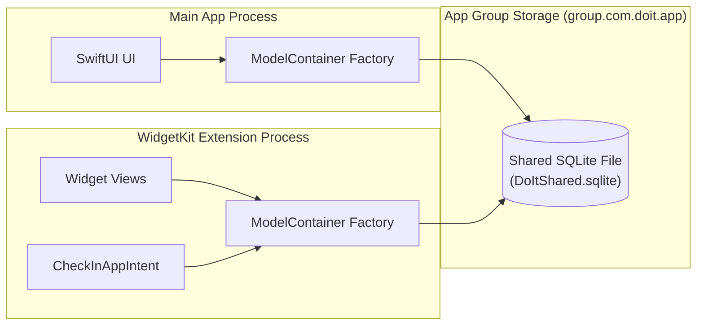

# Do It — iOS Developer Setup & Implementation Guide

This guide details the complete developer environment setup, capabilities, code signing, HealthKit integration, WidgetKit configuration, and test suites for the native **Do It** iOS application.

---

## 1. Prerequisites & Environment Requirements

| Component | Minimum Specification | Recommended |
| :--- | :--- | :--- |
| **macOS Host** | macOS Sonoma 14.5+ | macOS Sequoia 15.0+ |
| **Xcode Version** | Xcode 16.0 | Xcode 16.1+ |
| **Swift Language** | Swift 6.0 (Strict Concurrency Enabled) | Swift 6.0 |
| **iOS Deployment Target** | iOS 17.0+ | iOS 17.4+ |
| **Dependency Manager** | Swift Package Manager (SPM) | Swift Package Manager |
| **Hardware** | Apple Silicon Mac (M1/M2/M3/M4) | 16 GB+ Unified Memory |

### Core Swift Package Dependencies

Add the following packages in Xcode via **File > Add Package Dependencies...**:

- **Supabase Swift**: `https://github.com/supabase/supabase-swift` (version `2.15.0` or later)
  - Selected products: `Supabase`, `Auth`, `PostgREST`, `Realtime`, `Storage`
- **Factory** (Dependency Injection): `https://github.com/hmlongco/Factory` (version `2.3.0` or later)

---

## 2. Project Directory Structure

```
ios/
└── DoIt/
    ├── Package.swift                           # Swift Package Manager manifest (v5.9+)
    ├── DoIt.xcodeproj/                         # Xcode project configuration
    ├── Sources/
    │   ├── DoIt/                               # Core Application & Framework
    │   │   ├── Models/                         # Domain Entities (Habit, CheckIn, Duel, etc.)
    │   │   │   ├── Habit.swift
    │   │   │   ├── CheckIn.swift
    │   │   │   ├── HealthTelemetryRecord.swift
    │   │   │   └── AppState.swift
    │   │   ├── Services/                       # Calculators, Catalog, Audio, Haptics
    │   │   │   ├── ScoreCalculator.swift       # 240 Par & Leaderboard scoring
    │   │   │   ├── HabitCatalog.swift
    │   │   │   └── HapticsService.swift
    │   │   ├── ViewModels/                     # Observable State Models
    │   │   ├── Views/                          # SwiftUI Screens & Components
    │   │   │   ├── Today/                      # Daily Par & 1-tap logging
    │   │   │   ├── Battle/                     # Dual-player comparison
    │   │   │   ├── Cabinet/                    # Badges & Karma
    │   │   │   └── Settings/
    │   │   ├── Resources/                      # Entitlements, Assets, Plist
    │   │   │   ├── DoIt.entitlements           # HealthKit & App Groups
    │   │   │   ├── Info.plist                  # Privacy descriptions
    │   │   │   └── Assets.xcassets
    │   │   └── Utils/
    │   │       └── DateUtils.swift
    │   └── DoItWidgets/                        # WidgetKit Extension Target
    │       ├── DoItWidgetsBundle.swift
    │       ├── CheckInWidget.swift             # Home screen habit cards & progress meter
    │       └── Intents/
    │           └── CheckInAppIntent.swift      # Interactive 1-tap logging AppIntent
    └── Tests/
        └── DoItTests/
            ├── ScoreCalculatorTests.swift
            └── TelemetryTests.swift
```

---

## 3. Code Signing, Capabilities & Entitlements

The application requires specific capabilities configured across both the main application target (`DoIt`) and the widget extension (`DoItWidgets`).



### 3.1 Main App Entitlements (`DoIt/Resources/DoIt.entitlements`)

```xml
<?xml version="1.0" encoding="UTF-8"?>
<!DOCTYPE plist PUBLIC "-//Apple//DTD PLIST 1.0//EN" "http://www.apple.com/DTDs/PropertyList-1.0.dtd">
<plist version="1.0">
<dict>
    <key>com.apple.developer.healthkit</key>
    <true/>
    <key>com.apple.developer.healthkit.background-delivery</key>
    <true/>
    <key>com.apple.security.application-groups</key>
    <array>
        <string>group.com.doit.app</string>
    </array>
    <key>keychain-access-groups</key>
    <array>
        <string>$(AppIdentifierPrefix)com.doit.app</string>
    </array>
</dict>
</plist>
```

### 3.2 Privacy Usage Descriptions (`Info.plist`)

Apple requires transparent user-facing descriptions for health and camera usage. Add the following keys to `DoIt/Resources/Info.plist`:

```xml
<key>NSHealthShareUsageDescription</key>
<string>Do It reads your sleep stages, daily steps, and completed workouts to automatically score qualified habit check-ins against your dual-player targets.</string>

<key>NSHealthUpdateUsageDescription</key>
<string>Do It does not modify your health data. This permission is requested to maintain synchronization status.</string>

<key>NSCameraUsageDescription</key>
<string>Do It uses the camera to capture proof photos for habit completions.</string>

<key>NSPhotoLibraryUsageDescription</key>
<string>Do It allows you to select photo proof from your camera roll.</string>

<key>BGTaskSchedulerPermittedIdentifiers</key>
<array>
    <string>com.doit.app.healthkit.refresh</string>
    <string>com.doit.app.outbox.sync</string>
</array>
```

---

## 4. HealthKit Capabilities & Background Ingestion

### 4.1 HealthKitManager Implementation

Create `DoIt/Telemetry/HealthKitManager.swift` to handle authorization, observer queries, and anchored delta fetches:

```swift
import Foundation
import HealthKit
import OSLog

private let logger = Logger(subsystem: "com.doit.app", category: "HealthKitManager")

@MainActor
public final class HealthKitManager: ObservableObject {
    public static let shared = HealthKitManager()
    
    private let healthStore = HKHealthStore()
    private let anchorDefaultsKey = "HealthKitLastAnchor"
    
    // Types required for habit automation
    private let readTypes: Set<HKObjectType> = [
        HKObjectType.categoryType(forIdentifier: .sleepAnalysis)!,
        HKObjectType.quantityType(forIdentifier: .stepCount)!,
        HKObjectType.workoutType()
    ]
    
    @Published public var isAuthorized: Bool = false
    
    private init() {
        checkAuthorizationStatus()
    }
    
    public func requestAuthorization() async throws {
        guard HKHealthStore.isHealthDataAvailable() else {
            logger.error("HealthKit is unavailable on this device.")
            throw HealthKitError.notAvailable
        }
        
        try await healthStore.requestAuthorization(toShare: [], read: readTypes)
        checkAuthorizationStatus()
        
        if isAuthorized {
            try await enableBackgroundDeliveries()
        }
    }
    
    private func checkAuthorizationStatus() {
        guard HKHealthStore.isHealthDataAvailable() else { return }
        let sleepType = HKObjectType.categoryType(forIdentifier: .sleepAnalysis)!
        let status = healthStore.authorizationStatus(for: sleepType)
        self.isAuthorized = (status == .sharingAuthorized)
    }
    
    public func enableBackgroundDeliveries() async throws {
        for type in readTypes {
            guard let sampleType = type as? HKSampleType else { continue }
            
            // Enable immediate notifications for workouts, hourly for sleep & steps
            let frequency: HKUpdateFrequency = (sampleType is HKWorkoutType) ? .immediate : .hourly
            
            try await withCheckedThrowingContinuation { (continuation: CheckedContinuation<Void, Error>) in
                healthStore.enableBackgroundDelivery(for: sampleType, frequency: frequency) { success, error in
                    if let error = error {
                        logger.error("Failed background delivery for \(sampleType.identifier): \(error.localizedDescription)")
                        continuation.resume(throwing: error)
                    } else {
                        logger.info("Enabled background delivery for \(sampleType.identifier)")
                        continuation.resume(returning: ())
                    }
                }
            }
            
            startObserverQuery(for: sampleType)
        }
    }
    
    private func startObserverQuery(for sampleType: HKSampleType) {
        let query = HKObserverQuery(sampleType: sampleType, predicate: nil) { [weak self] _, completionHandler, error in
            guard error == nil else {
                completionHandler()
                return
            }
            
            Task {
                await self?.fetchAnchoredChanges(for: sampleType)
                completionHandler()
            }
        }
        healthStore.execute(query)
    }
    
    private func fetchAnchoredChanges(for sampleType: HKSampleType) async {
        let anchorKey = "\(anchorDefaultsKey)_\(sampleType.identifier)"
        var anchor: HKQueryAnchor? = nil
        
        if let anchorData = UserDefaults.standard.data(forKey: anchorKey),
           let savedAnchor = try? NSKeyedUnarchiver.unarchivedObject(ofClass: HKQueryAnchor.self, from: anchorData) {
            anchor = savedAnchor
        }
        
        let queryDescriptor = HKAnchoredObjectQueryDescriptor(
            sampleType: sampleType,
            predicate: nil,
            anchor: anchor,
            limit: HKObjectQueryNoLimit
        )
        
        do {
            let result = try await queryDescriptor.result(for: healthStore)
            
            // Save new anchor
            if let newAnchor = result.newAnchor,
               let data = try? NSKeyedArchiver.archivedData(withRootObject: newAnchor, requiringSecureCoding: true) {
                UserDefaults.standard.set(data, forKey: anchorKey)
            }
            
            // Dispatch added samples to Normalizer
            if !result.addedSamples.isEmpty {
                await TelemetryNormalizer.shared.processSamples(result.addedSamples)
            }
        } catch {
            logger.error("Error executing anchored query: \(error.localizedDescription)")
        }
    }
}

public enum HealthKitError: LocalizedError {
    case notAvailable
    case permissionDenied
}
```

---

## 5. Shared SwiftData Container & WidgetKit Setup

Widgets run in a separate process and require access to the shared database container via Apple App Groups.



### 5.1 Shared ModelContainer Factory (`ModelContainerFactory.swift`)

```swift
import Foundation
import SwiftData

public struct ModelContainerFactory {
    public static let sharedContainer: ModelContainer = {
        let schema = Schema([
            HabitEntity.self,
            CheckInEntity.self,
            RestDayEntity.self,
            PendingMutationEntity.self
        ])
        
        guard let groupURL = FileManager.default.containerURL(
            forSecurityApplicationGroupIdentifier: "group.com.doit.app"
        ) else {
            fatalError("Could not access App Group URL: group.com.doit.app")
        }
        
        let databaseURL = groupURL.appendingPathComponent("DoItShared.sqlite")
        let modelConfiguration = ModelConfiguration(
            schema: schema,
            url: databaseURL,
            allowsSave: true
        )
        
        do {
            return try ModelContainer(for: schema, configurations: [modelConfiguration])
        } catch {
            fatalError("Failed to initialize SwiftData ModelContainer: \(error)")
        }
    }()
}
```

### 5.2 Interactive Widget 1-Tap Logging Intent (`CheckInAppIntent.swift`)

Create `DoItWidgets/Intents/CheckInAppIntent.swift` to allow instantaneous habit check-ins directly from the Home Screen or Lock Screen:

```swift
import AppIntents
import SwiftData
import WidgetKit

public struct CheckInAppIntent: AppIntent {
    public static var title: LocalizedStringResource = "Log Habit Check-In"
    public static var description = IntentDescription("Records a completion for the selected habit.")
    
    @Parameter(title: "Habit ID")
    var habitId: String
    
    @Parameter(title: "Duel ID")
    var duelId: String
    
    @Parameter(title: "Player Slot")
    var playerSlot: String
    
    @Parameter(title: "Points Awarded")
    var points: Int
    
    public init() {}
    
    public init(habitId: String, duelId: String, playerSlot: String, points: Int) {
        self.habitId = habitId
        self.duelId = duelId
        self.playerSlot = playerSlot
        self.points = points
    }
    
    public func perform() async throws -> some IntentResult {
        let context = ModelContext(ModelContainerFactory.sharedContainer)
        let today = ISO8601DateFormatter().string(from: Date()).prefix(10) // YYYY-MM-DD
        let dateString = String(today)
        
        // 1. Check idempotency: avoid double-logging
        let checkInId = "manual-\(habitId)-\(dateString)"
        let fetchDescriptor = FetchDescriptor<CheckInEntity>(
            predicate: #Predicate { $0.id == checkInId }
        )
        
        if let existing = try? context.fetch(fetchDescriptor), !existing.isEmpty {
            // Already logged today; trigger widget reload and return
            WidgetCenter.shared.reloadAllTimelines()
            return .result()
        }
        
        // 2. Insert CheckIn
        let checkIn = CheckInEntity(
            id: checkInId,
            duelId: duelId,
            habitId: habitId,
            playerSlot: playerSlot,
            date: dateString,
            pointsEarned: points,
            completedAt: Date(),
            source: "manual"
        )
        context.insert(checkIn)
        
        // 3. Enqueue PendingMutation for background sync
        let mutation = PendingMutationEntity(
            mutationId: UUID(),
            duelId: duelId,
            tableName: "duel_check_ins",
            operation: "UPSERT",
            recordId: checkInId,
            payload: checkIn.toJSONString(),
            createdAt: Date()
        )
        context.insert(mutation)
        
        try context.save()
        
        // 4. Invalidate Widget timeline
        WidgetCenter.shared.reloadAllTimelines()
        
        return .result()
    }
}
```

---

## 6. Testing, SwiftUI Previews & CI Commands

### 6.1 SwiftUI Preview Configuration with In-Memory SwiftData

To run SwiftUI previews without touching the disk or App Group containers:

```swift
import SwiftUI
import SwiftData

struct HabitCard_Previews: PreviewProvider {
    static var previews: some View {
        let config = ModelConfiguration(isStoredInMemoryOnly: true)
        let container = try! ModelContainer(for: HabitEntity.self, configurations: config)
        let sampleHabit = HabitEntity(
            id: "gym-workout",
            duelId: "sample-duel",
            playerSlot: "maciek",
            title: "Gym Workout",
            points: 40,
            category: "physical",
            order: 1
        )
        container.mainContext.insert(sampleHabit)
        
        return HabitCardView(habit: sampleHabit)
            .modelContainer(container)
            .preferredColorScheme(.dark)
    }
}
```

### 6.2 Running Tests & Build Automation via CLI

From the root of the repository or the `ios/` folder:

```bash
# 1. Clean build directory
xcodebuild clean -project ios/DoIt.xcodeproj -scheme DoIt

# 2. Run unit and integration tests on an iPhone 16 Simulator
xcodebuild test \
  -project ios/DoIt.xcodeproj \
  -scheme DoIt \
  -destination 'platform=iOS Simulator,name=iPhone 16,OS=18.0' \
  -enableCodeCoverage YES \
  CODE_SIGN_IDENTITY="" \
  CODE_SIGNING_REQUIRED=NO \
  CODE_SIGNING_ALLOWED=NO

# 3. Archive release build for TestFlight distribution
xcodebuild archive \
  -project ios/DoIt.xcodeproj \
  -scheme DoIt \
  -configuration Release \
  -archivePath build/DoIt.xcarchive
```
