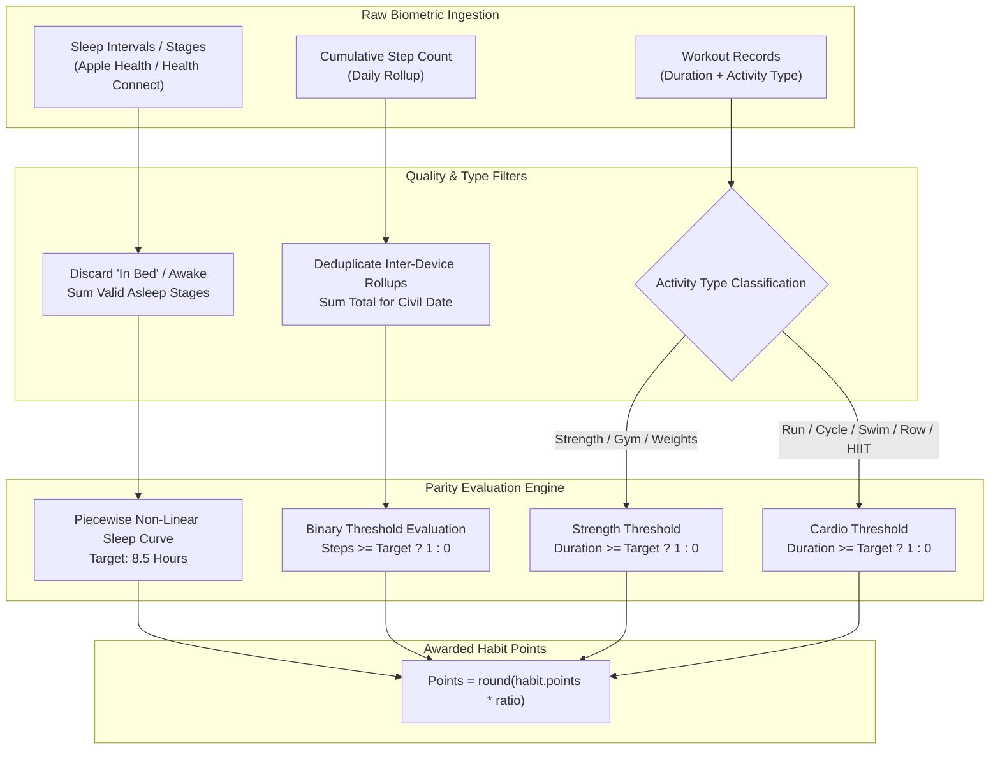
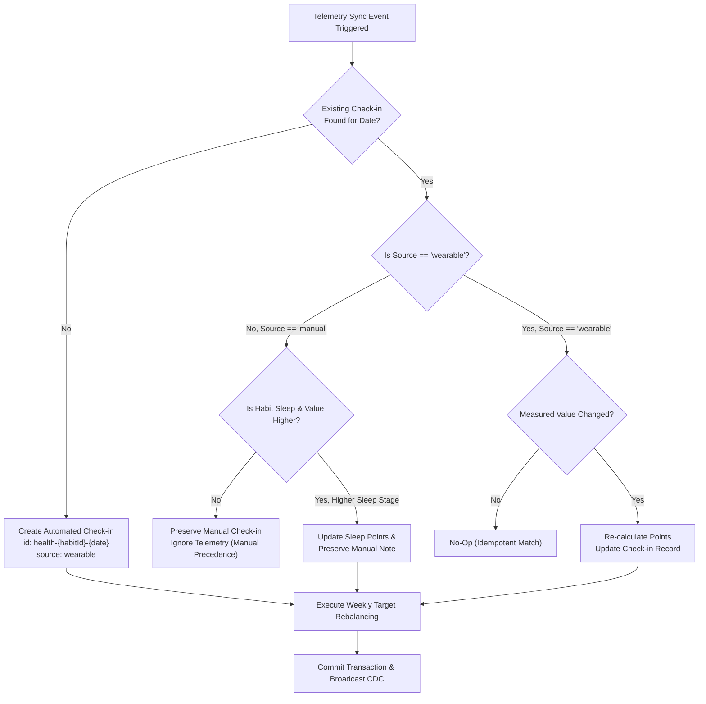
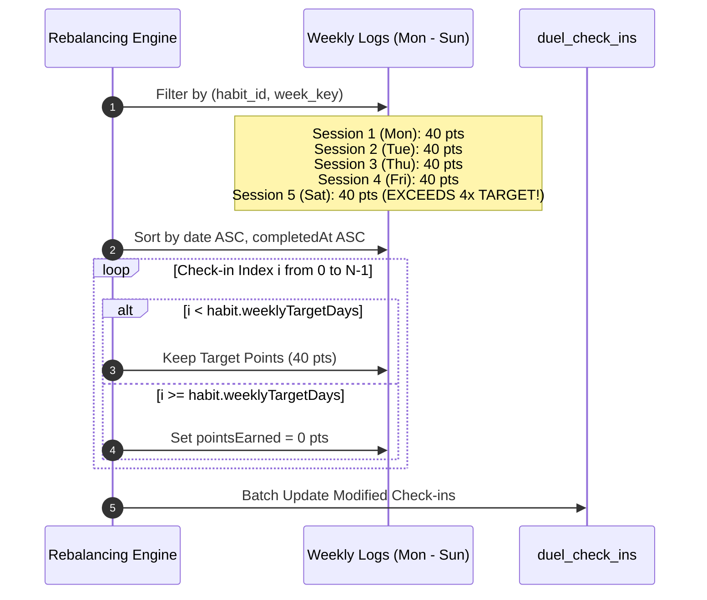

# Do It — Wearable Telemetry & Scoring Specification

This specification governs how passive wearable biometrics (Sleep Analysis, Daily Step Count, Cardio Sessions, and Strength Workouts) from **Apple HealthKit** and **Android Health Connect** map deterministically into the **Do It** 240 Daily Par habit economy.

---

## 1. Architectural Philosophy & Principles

1. **Biometric Integrity**: Passive tracking must never undermine competitive parity. Sleep requires actual physiological recovery (stages or verified asleep intervals), not passive "time in bed."
2. **Deterministic Parity**: Players have asymmetric routines (e.g., Strength Training vs. Running), but both compete against identical point ceilings.
3. **Strict Manual Precedence**: A user's explicit manual check-in always overrides automated background sync, preventing an uncalibrated tracker from degrading an intentional completion.
4. **Idempotent Deduction**: A background synchronization cycle can execute dozens of times per day without duplicating points or creating conflicting state.
5. **Flexible Session Rebalancing**: Extra workout sessions beyond a habit's weekly target (e.g., 5th gym session on a `4x/wk` habit) preserve habit adherence streaks and activity feed visibility, but earn **0 points** to maintain weekly parity.

---

## 2. Supported Metrics & Scoring Algorithms



---

### 2.1 Sleep Metric (`metric = "sleep"`)

- **Full Points Target**: $8.5\text{ hours}$ ($510\text{ minutes}$).
- **Minimum Qualification Cutoff**: $6.5\text{ hours}$ ($390\text{ minutes}$).
- **Data Filtering Rule**: Only time spent in verified sleep states (`asleepCore`, `asleepDeep`, `asleepREM` or reconciled `minutesAsleep`) counts. Time recorded purely as `inBed` without sleep staging is explicitly rejected.

#### Piecewise Non-Linear Reward Ratio Curve

The sleep ratio function $R_{\text{sleep}}(h)$ assigns graduated rewards to encourage sleep hygiene while penalizing severe deprivation:

$$R_{\text{sleep}}(h) = \begin{cases} 
0.00 & \text{if } h < 6.5 \\
0.20 + \dfrac{h - 6.5}{0.5} \times (0.40 - 0.20) & \text{if } 6.5 \le h < 7.0 \\
0.40 + \dfrac{h - 7.0}{0.5} \times (0.60 - 0.40) & \text{if } 7.0 \le h < 7.5 \\
0.60 + \dfrac{h - 7.5}{0.5} \times (0.90 - 0.60) & \text{if } 7.5 \le h < 8.0 \\
0.90 + \dfrac{h - 8.0}{0.5} \times (1.00 - 0.90) & \text{if } 8.0 \le h < 8.5 \\
1.00 & \text{if } h \ge 8.5
\end{cases}$$

#### Milestone Reference Table

| Measured Asleep Time ($h$) | Reward Ratio ($R$) | Example Points ($P = 30$) | Status Tier | Display Color |
| :--- | :--- | :--- | :--- | :--- |
| $< 6.50\text{ hrs}$ ($< 6\text{h } 30\text{m}$) | **$0.00$** | **$0$ pts** | Critical / Incomplete | Red (`#ef4444`) |
| $6.50\text{ hrs}$ ($6\text{h } 30\text{m}$) | **$0.20$** | **$6$ pts** | Low Progress | Dark Orange (`#f97316`) |
| $7.00\text{ hrs}$ ($7\text{h } 00\text{m}$) | **$0.40$** | **$12$ pts** | Halfway | Yellow (`#eab308`) |
| $7.50\text{ hrs}$ ($7\text{h } 30\text{m}$) | **$0.60$** | **$18$ pts** | Almost There | Lime (`#84cc16`) |
| $8.00\text{ hrs}$ ($8\text{h } 00\text{m}$) | **$0.90$** | **$27$ pts** | Almost There | Lime (`#84cc16`) |
| $\ge 8.50\text{ hrs}$ ($8\text{h } 30\text{m}+$) | **$1.00$** | **$30$ pts** | Goal Met (Perfect) | Emerald Green (`#10b981`) |

Points awarded:
$$\text{PointsEarned} = \operatorname{round}(\text{habit.points} \times R_{\text{sleep}}(h))$$

---

### 2.2 Step Count Metric (`metric = "steps"`)

- **Target**: Configured per habit (e.g., $10,000\text{ steps}$).
- **Evaluation Mechanism**: Daily civil cumulative rollup.
- **Scoring Function**: Binary pass/fail threshold:

$$R_{\text{steps}}(s) = \begin{cases} 
1.00 & \text{if } s \ge \text{target} \\ 
0.00 & \text{if } s < \text{target} 
\end{cases}$$

$$\text{PointsEarned} = \operatorname{round}(\text{habit.points} \times R_{\text{steps}}(s))$$

---

### 2.3 Strength Training Metric (`metric = "workout"`)

- **Classification Regex**: `/STRENGTH|WEIGHT|LIFT|GYM/i`
- **Native Types**:
  - iOS HealthKit: `.traditionalStrengthTraining`, `.functionalStrengthTraining`
  - Android Health Connect: `ExerciseSessionRecord.EXERCISE_TYPE_WEIGHTLIFTING`, `EXERCISE_TYPE_CALISTHENICS`, `EXERCISE_TYPE_STRENGTH_TRAINING`
- **Target**: Minimum active minutes (e.g., $45\text{ minutes}$).
- **Scoring Function**:
  $$R_{\text{workout}}(m) = \begin{cases} 1.00 & \text{if } m \ge \text{target} \\ 0.00 & \text{if } m < \text{target} \end{cases}$$

---

### 2.4 Cardio Metric (`metric = "cardio"`)

- **Classification Regex**: `/RUN|BIK|CYCL|AEROBIC|SWIM|ROW|CARDIO|WALK|HIIT|ELLIPTICAL/i`
- **Native Types**:
  - iOS HealthKit: `.running`, `.cycling`, `.swimming`, `.rowing`, `.highIntensityIntervalTraining`, `.hiking`, `.elliptical`
  - Android Health Connect: `EXERCISE_TYPE_RUNNING`, `EXERCISE_TYPE_BIKING`, `EXERCISE_TYPE_SWIMMING`, `EXERCISE_TYPE_ROWING`, `EXERCISE_TYPE_HIGH_INTENSITY_INTERVAL_TRAINING`
- **Target**: Minimum active minutes (e.g., $30\text{ minutes}$).
- **Scoring Function**:
  $$R_{\text{cardio}}(m) = \begin{cases} 1.00 & \text{if } m \ge \text{target} \\ 0.00 & \text{if } m < \text{target} \end{cases}$$

---

## 3. Idempotent Check-In Deduction Engine

Every telemetry deduction must respect composite constraints, manual priority, and late-arriving wearable data.



### 3.1 Idempotency Key Specification

- **Database Constraint**: `UNIQUE (duel_id, habit_id, date)` on `public.duel_check_ins`.
- **Deterministic Identifier Format**:
  $$\text{id} = \text{"health-" } \Vert \text{ habit.id } \Vert \text{ "-" } \Vert \text{ date}$$
  Where `date` is formatted in ISO-8601 Civil Date (`YYYY-MM-DD`) matching the player's current local timezone.

### 3.2 48-Hour Settling Window
Wearables do not always sync immediately. Sleep staging algorithms (e.g., Oura Ring or Whoop Cloud) frequently revise stage summaries hours after wake time:
- The telemetry engine recalculates data across a trailing 48-hour window:
  $$[\text{today} - 2\text{ days}, \quad \text{today}]$$
- If revised stages alter sleep duration from $7.2\text{h}$ to $8.1\text{h}$, the check-in is updated in place, recomputing points from $15 \rightarrow 27$ and notifying the peer client.

---

## 4. Weekly Session Rebalancing Algorithm

For flexible target habits (e.g., Gym `4x/wk` or Cardio `3x/wk`), players can complete more sessions than the target. However, competitive parity requires that points are strictly capped at the weekly quota.

### Rebalancing Invariants

1. **Quota Ceiling**: Exactly $\min(N, \text{weeklyTargetDays})$ check-ins receive full points in any calendar week, where $N$ is the total sessions logged.
2. **Chronological Priority**: Check-ins are ordered chronologically by `date ASC`, followed by `completedAt ASC`. The first $K$ sessions earn points; subsequent sessions earn $0$ points.
3. **Streak & Activity Preservation**: Check-ins with $0$ points remain in the activity feed, count toward weekly consistency badges, and maintain daily streaks.



---

## 5. Reference Implementations

### 5.1 Swift Reference Implementation (`TelemetryNormalizer.swift`)

```swift
import Foundation

public struct TelemetryNormalizer {
    public static let sleepFullPointsHours: Double = 8.5
    public static let sleepCutoffHours: Double = 6.5
    
    private static let sleepMilestones: [(hours: Double, ratio: Double)] = [
        (6.5, 0.20),
        (7.0, 0.40),
        (7.5, 0.60),
        (8.0, 0.90),
        (8.5, 1.00)
    ]
    
    public static func calculateSleepRewardRatio(hours: Double) -> Double {
        guard hours.isFinite, hours >= sleepCutoffHours else { return 0.0 }
        if hours >= sleepFullPointsHours { return 1.0 }
        
        for i in 1..<sleepMilestones.count {
            let lower = sleepMilestones[i - 1]
            let upper = sleepMilestones[i]
            if hours <= upper.hours {
                let fraction = (hours - lower.hours) / (upper.hours - lower.hours)
                return lower.ratio + fraction * (upper.ratio - lower.ratio)
            }
        }
        return 1.0
    }
    
    public static func calculateHealthPoints(
        habitPoints: Int,
        metric: String,
        target: Double,
        measuredValue: Double
    ) -> Int {
        guard measuredValue.isFinite else { return 0 }
        let ratio: Double
        if metric == "sleep" {
            ratio = calculateSleepRewardRatio(hours: measuredValue)
        } else {
            ratio = measuredValue >= target ? 1.0 : 0.0
        }
        return Int((Double(habitPoints) * ratio).rounded())
    }
}
```

### 5.2 Kotlin Reference Implementation (`TelemetryNormalizer.kt`)

```kotlin
package com.doit.app.telemetry

import kotlin.math.roundToInt

object TelemetryNormalizer {
    const val SLEEP_FULL_POINTS_HOURS = 8.5
    const val SLEEP_CUTOFF_HOURS = 6.5

    private data class Milestone(val hours: Double, val ratio: Double)

    private val sleepMilestones = listOf(
        Milestone(6.5, 0.20),
        Milestone(7.0, 0.40),
        Milestone(7.5, 0.60),
        Milestone(8.0, 0.90),
        Milestone(8.5, 1.00)
    )

    fun calculateSleepRewardRatio(hours: Double): Double {
        if (!hours.isFinite() || hours < SLEEP_CUTOFF_HOURS) return 0.0
        if (hours >= SLEEP_FULL_POINTS_HOURS) return 1.0

        for (i in 1 until sleepMilestones.size) {
            val lower = sleepMilestones[i - 1]
            val upper = sleepMilestones[i]
            if (hours <= upper.hours) {
                val fraction = (hours - lower.hours) / (upper.hours - lower.hours)
                return lower.ratio + fraction * (upper.ratio - lower.ratio)
            }
        }
        return 1.0
    }

    fun calculateHealthPoints(
        habitPoints: Int,
        metric: String,
        target: Double,
        measuredValue: Double
    ): Int {
        if (!measuredValue.isFinite()) return 0
        val ratio = if (metric == "sleep") {
            calculateSleepRewardRatio(measuredValue)
        } else {
            if (measuredValue >= target) 1.0 else 0.0
        }
        return (habitPoints * ratio).roundToInt()
    }
}
```
